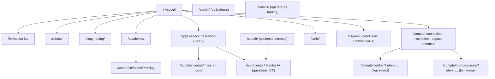
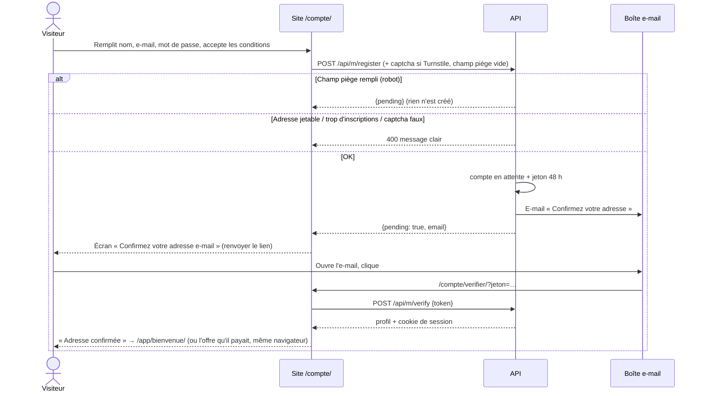
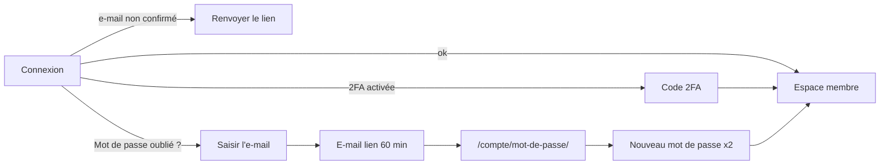
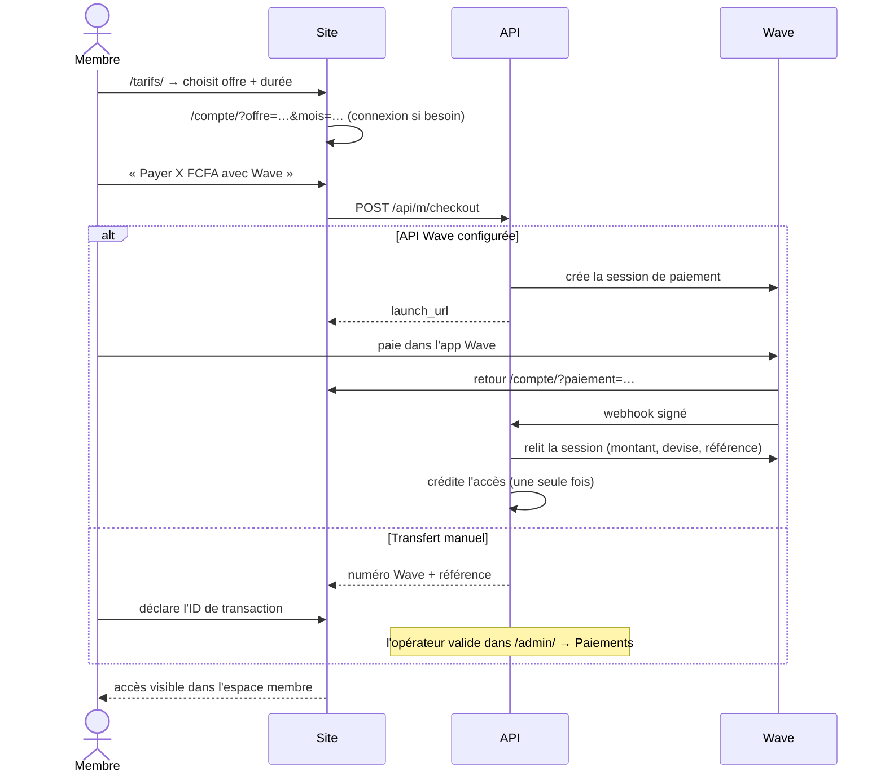
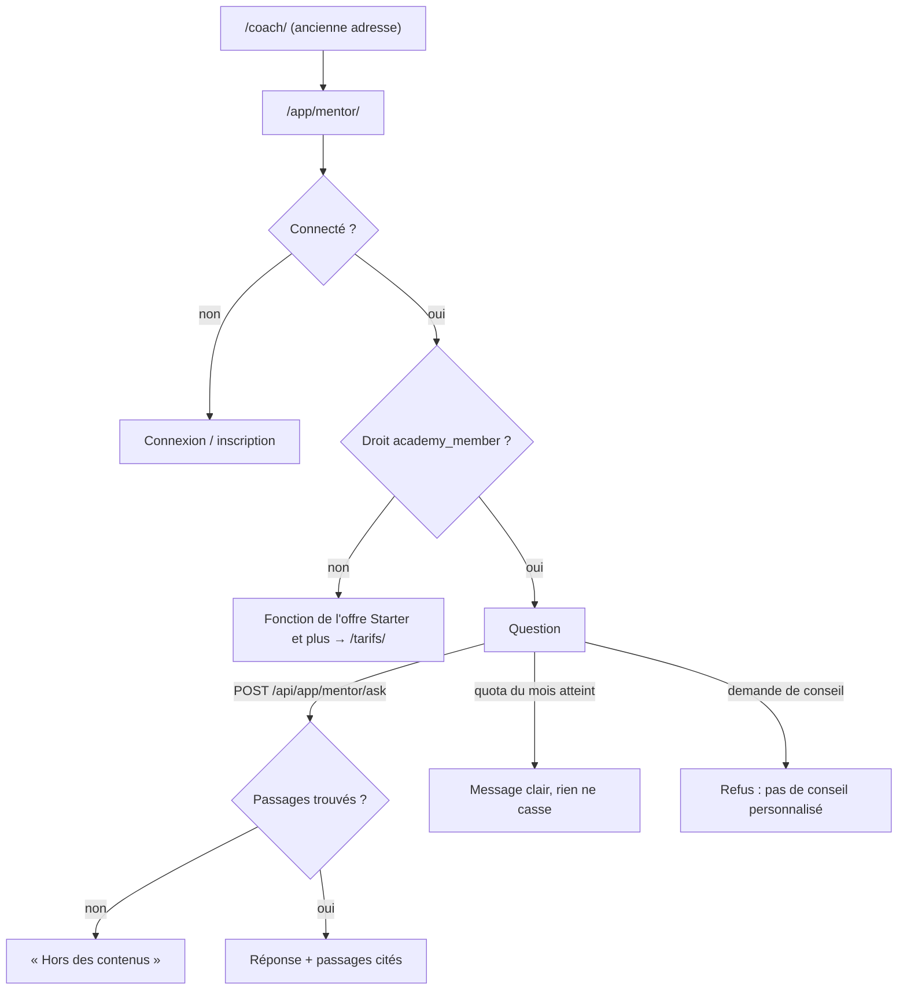
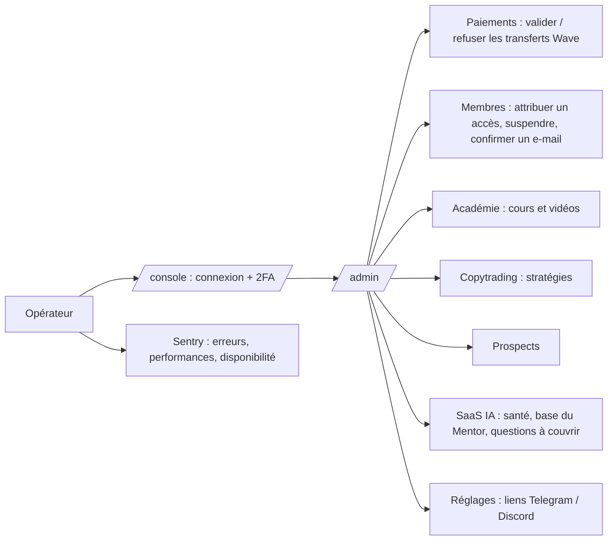

# App Flow : pages et parcours (v0.4)

> Toutes les pages et les chemins que suivent visiteurs, membres et opérateurs. Les diagrammes
> s'affichent sur GitHub (Mermaid).

## 1. Plan du site

| Page | Accès | Rôle |
|---|---|---|
| `/` | public | présentation, offres, robots, FAQ |
| `/formation-ict/` | public | programme Victorious Trader, achat |
| `/robots/` | public | catalogue des EA |
| `/copytrading/` | public ; suivre = membre | stratégies, copie démo |
| `/academie/`, `/academie/cours/` | public ; vidéos selon les droits | cours vidéo |
| `/app/` | membre connecté | espace de trading : tableau de bord, journal, revue du Coach, analyse ICT, risque, Mentor, laboratoire, usine EA, formation, réglages (fonctions selon l'offre, voir [SAAS.md](SAAS.md)) |
| `/app/bienvenue/` | membre connecté | mise en route en 4 étapes (profil, prop firm, plan de risque, premier compte) |
| `/app/mentor/` | droit `academy_member` | questions sur ICT et la formation, passages cités |
| `/coach/` | public | ancienne adresse du coach : renvoie vers `/app/mentor/` |
| `/tarifs/` | public | offres et durées, paiement Wave |
| `/compte/` | public → membre | connexion, inscription, mot de passe oublié, espace membre, paiements |
| `/compte/verifier/` | lien e-mail | confirme l'adresse et connecte |
| `/compte/mot-de-passe/` | lien e-mail | nouveau mot de passe |
| `/admin/` | opérateur connecté à la console | pilotage du site |
| `/console` | opérateur | bots, MT5, arrêt d'urgence |

## 2. Inscription et confirmation d'e-mail

Cas particuliers :

- **Connexion avant confirmation** → 403 « e-mail non confirmé » + bouton **Renvoyer le lien**.
- **Lien expiré ou déjà utilisé** → page « Lien non valide » → connexion → renvoyer le lien.
- **Faute de frappe dans l'e-mail** → se réinscrire avec la bonne adresse ; l'ancienne
  inscription en attente disparaît après 7 jours.
- **E-mail jamais reçu** → l'opérateur peut confirmer à la main dans `/admin/` → Membres.

## 3. Connexion et mot de passe oublié

Après un changement de mot de passe, toutes les anciennes sessions sont fermées. Un compte
avec 2FA doit se reconnecter normalement.

## 4. Achat d'une offre (Wave)

## 5. Questions ICT : le Mentor

- Sources : fiches ICT, définitions du moteur, cours de l'académie, documents de l'équipe,
  filtrés selon les droits du membre.
- Sous chaque réponse : les passages cités et un verdict (sourcée, partielle, hors des contenus).
- Sans IA : les passages les plus proches, tels quels, avec un avertissement.

## 6. Académie

Catalogue → cours → parties. Une partie verrouillée affiche l'offre qui la débloque ; la
progression est enregistrée toutes les quelques secondes (`POST /api/m/progress`).

## 7. Copytrading (démo)

`/copytrading/` → stratégie → réglages (allocation, multiplicateur, drawdown max) → accepter
l'avertissement → suivi démo. Arrêt manuel ou automatique au drawdown max. Aucun ordre réel.

## 8. Opérateurs

Les opérateurs sont créés uniquement sur le serveur :
`python -m hedgefund.web create-user --username NOM`.

## 9. États vides et erreurs (à respecter sur toute nouvelle page)

| Situation | Comportement attendu |
|---|---|
| Chargement | `<Spinner />` avec un libellé |
| Liste vide | `<Empty />` avec une phrase utile et, si possible, une action |
| Erreur API | `<Notice kind="error">` avec le message du serveur (déjà en français) |
| Réseau coupé | « Connexion impossible : vérifiez votre réseau. » |
| Non connecté | invitation à se connecter, jamais une page blanche |
| Droit manquant | ce que l'offre débloque + lien vers `/tarifs/` |
