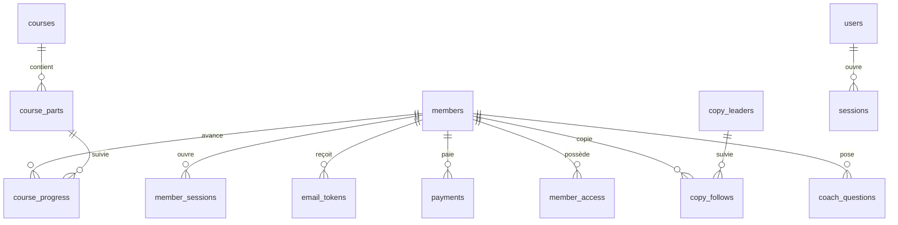

# Backend Schema : données et API (v0.4)

> Tables SQLite, relations, droits d'accès et routes HTTP. Code de référence :
> `hedgefund/bots/store.py`, `hedgefund/members/*.py`, `hedgefund/coach/__init__.py`,
> `hedgefund/core/ledger.py`.

## 1. Stockage

| Fichier | Contenu | Écriture |
|---|---|---|
| `var/platform.db` | état : opérateurs, membres, sessions, paiements, accès, cours, copytrading, coach, réglages, bots | lecture/écriture (WAL) |
| `var/platform_<mode>.db` (un par mode : simulation, papier, MT5) | journal d'audit chaîné par hash | **ajout seulement** (triggers interdisent UPDATE/DELETE) |
| `config/site.yaml` | catalogue d'offres, prix, textes | fichier versionné |
| `hedgefund/coach/knowledge/*.md` | base du Coach IA | fichiers versionnés |

Horodatages : entiers **secondes Unix UTC** (sauf le journal en millisecondes). Montants en
**FCFA entiers** (`XOF`).

## 2. Diagramme

## 3. Tables

### Comptes

**`users`** (opérateurs de la console)

| Colonne | Type | Note |
|---|---|---|
| id | INTEGER PK | |
| username | TEXT UNIQUE | créé seulement en ligne de commande |
| password_hash | TEXT | scrypt |
| totp_secret, totp_enabled | TEXT, INTEGER | 2FA |
| created_at | INTEGER | |

**`sessions`** / **`member_sessions`** : `token_hash` (PK, SHA-256 du jeton), `user_id`,
`csrf`, `created_at`, `last_seen`, `expires_at`, `ip`, `user_agent`.

**`login_attempts`** : `key`, `ts`, `ok`. Sert aux limites : échecs de connexion
(`m:u:<email>`, `m:ip:<ip>`), inscriptions (`reg:<ip>`), prospects (`lead:<ip>`), e-mails de
confirmation (`mailv:<email>`, `mailv-ip:<ip>`), réinitialisations (`reset:<email>`,
`reset-ip:<ip>`). Purge des lignes de plus de 7 jours.

**`members`**

| Colonne | Type | Note |
|---|---|---|
| id | INTEGER PK | |
| email | TEXT UNIQUE | minuscules |
| name, phone | TEXT | téléphone facultatif (Wave) |
| password_hash | TEXT | scrypt |
| totp_secret, totp_enabled | | |
| status | TEXT | `active` / `suspended` |
| terms_version | TEXT | version des conditions acceptées (`2026-10`) |
| created_at | INTEGER | |
| **email_verified_at** | INTEGER NULL | 🆕 v0.4 ; NULL = inscription en attente |

**`email_tokens`** 🆕

| Colonne | Type | Note |
|---|---|---|
| token_hash | TEXT PK | SHA-256 du jeton envoyé |
| member_id | INTEGER | |
| purpose | TEXT | `verify` (48 h) ou `reset` (60 min) |
| created_at, expires_at | INTEGER | |
| used_at | INTEGER NULL | usage unique |

Index `idx_email_tokens_member(member_id, purpose)`. Un seul lien vivant par membre et par
usage (les anciens sont supprimés à l'émission).

### Paiements et accès

**`payments`** : `id` (`pay_…`), `member_id`, `offer`, `months` (0 = à vie), `amount`,
`currency`, `method` (`wave_checkout`, `wave_manual`, `grant`), `status` (`pending`,
`declared`, `succeeded`, `failed`, `expired`, `rejected`), `provider_id` (session Wave),
`launch_url`, `transaction_ref`, `note`, `created_at`, `updated_at`, `applied_at` (crédit
appliqué une seule fois). Index uniques sur `provider_id` et `transaction_ref` (hors
refusés).

**`member_access`** : (`member_id`, `product`) PK, `starts_at`, `expires_at` (NULL = à vie),
`updated_at`. Un renouvellement prolonge depuis la date de fin si elle est future.

**`leads`** : (`email`, `interest`) PK, `created_at`.

### Académie

**`courses`** (`id`, `slug` unique, `title`, `subtitle`, `description`, `level`, `access`,
`status` draft/soon/published, `position`) ; **`course_parts`** (`course_id`, `position`,
`title`, `summary`, `duration_s`, `provider`, `video_ref`, `chapters` JSON, `free_preview`) ;
**`course_progress`** ((`member_id`, `part_id`) PK, `position_s`, `completed`).

### Copytrading

**`copy_leaders`** (stratégies : `bot_id`, `risk_level`, `ref_capital`, `status`) ;
**`copy_follows`** (`member_id`, `leader_id`, `mode` demo/live, `allocation`, `multiplier`,
`max_drawdown_pct`, `status`, `stop_reason`, `accepted_risk_at`…).

### Coach IA 🆕

**`coach_questions`**

| Colonne | Type | Note |
|---|---|---|
| id | INTEGER PK | |
| member_id | INTEGER | |
| ts | INTEGER | |
| day | TEXT | `AAAA-MM-JJ` UTC, pour le quota |
| question | TEXT | ≤ 2 000 caractères |
| sources | TEXT | ids de fiches séparés par des virgules |
| out_of_base | INTEGER | 1 si « hors base » |
| input_tokens, output_tokens | INTEGER | suivi du coût |

Index `idx_coach_member_day(member_id, day)`. Les réponses ne sont pas stockées.

### Plateforme

**`settings`** (clé/valeur : liens Telegram/Discord, mode, capital…), **`bots`** (JSON).

**Journal `events`** : `seq`, `ts` (ms), `kind`, `ref`, `payload` JSON, `prev_hash`, `hash`.
Événements opérateur ajoutés en v0.4 : `email_verified`, `member_password_reset`,
`signup_blocked`, `member_email_verified`.

## 4. Migrations

Pas d'outil de migration : chaque module crée ses tables avec `CREATE TABLE IF NOT EXISTS` au
démarrage. Une **nouvelle colonne** s'ajoute dans une fonction idempotente comme
`hedgefund.members.service.migrate()` :

1. lire `PRAGMA table_info(<table>)` ;
2. `ALTER TABLE … ADD COLUMN` si elle manque ;
3. remplir les lignes existantes si nécessaire ;
4. ajouter la colonne aussi dans le `CREATE TABLE` pour les bases neuves ;
5. écrire un test qui part d'une ancienne base (voir
   `tests/test_signup_security.py::test_migration_keeps_existing_members_confirmed_and_purges_old_pending`).

**Toujours sauvegarder `var/` avant de déployer une version qui modifie le schéma.**

## 5. Droits (entitlements)

Un produit donne un ensemble de droits ; les pages et routes vérifient les droits, jamais le
nom de l'offre. Définis dans `hedgefund/members/site.py::ENTITLEMENTS`, attribués dans
`config/site.yaml`.

| Droit | Gratuit | Starter | Pro Trader | Quant Elite | Formation ICT | Groupe Elite |
|---|---|---|---|---|---|---|
| academy_free | ✔ | ✔ | ✔ | ✔ | ✔ | ✔ |
| academy_member | | ✔ | ✔ | ✔ | | |
| community_private | | ✔ | ✔ | ✔ | ✔ | ✔ |
| analyses, calendar, webinars | | ✔ | ✔ | ✔ | | |
| ea_one / ea_all | | | ea_one | les deux | | |
| performance, mt5_connect, lab, copy_live | | | ✔ | ✔ | | |
| **coach_ia** | | | | ✔ | | |
| formation_ict | | | | ✔ | ✔ | |
| formation_ea, priority_support, early_access | | | | ✔ | | |
| elite_group | | | | | | ✔ |
| copy_demo | ✔ | ✔ | ✔ | ✔ | | ✔ |

Un compte **non confirmé** n'a **aucun** droit.

## 6. API

Conventions : JSON, erreurs `{"detail": "message en français"}`, `Cache-Control: no-store`.
Toute écriture authentifiée exige `X-CSRF-Token` + `Origin` du site.

### Public

| Méthode | Route | Rôle |
|---|---|---|
| GET | `/api/health` | état (supervision) |
| GET | `/api/site` | catalogue, contact, options (`email_verification`, `turnstile_site_key`, `coach`, `sentry`) |
| GET | `/api/site/robots`, `/api/site/quotes`, `/api/site/leaders`, `/api/site/courses`, `/api/site/courses/{slug}` | contenus publics |
| POST | `/api/site/leads` | liste d'attente (10/h/IP) |

### Comptes membres

| Méthode | Route | Corps | Réponse |
|---|---|---|---|
| POST | `/api/m/register` | `email, password, name, phone?, accept_terms, website (piège), captcha?` | `{pending, email}` (ou profil si confirmation désactivée) |
| POST | `/api/m/verify` | `token` | profil + cookie |
| POST | `/api/m/verify/resend` | `email` | `{ok}` toujours |
| POST | `/api/m/password/forgot` | `email` | `{ok}` toujours |
| POST | `/api/m/password/reset` | `token, password` | `{member}` (null si 2FA) |
| POST | `/api/m/login` | `email, password, totp?` | profil + cookie ; 403 si non confirmé/suspendu |
| POST | `/api/m/logout` | — | `{ok}` |
| GET | `/api/m/me`, `/api/m/session` | — | profil (avec `email_verified`, `csrf`) |

### Membres connectés

| Méthode | Route | Rôle |
|---|---|---|
| POST | `/api/m/checkout` | démarrer un paiement Wave |
| GET | `/api/m/payments`, `/api/m/payments/{id}` | historique, état (relu chez Wave) |
| POST | `/api/m/payments/{id}/declare` | déclarer un transfert manuel |
| POST | `/api/m/progress` | progression vidéo |
| GET/POST | `/api/m/coach` | état du coach / poser une question (`question`, `history[]`) |
| GET/POST | `/api/m/copy`, GET `/api/m/copy/{id}`, POST `/api/m/copy/{id}/stop` | copytrading démo |

### Webhook

`POST /api/webhooks/wave` : signature `Wave-Signature` (HMAC) ou Bearer secret ; le paiement
est relu dans l'API Wave avant crédit.

### Administration (session console)

`GET /api/admin/overview` (avec `members` confirmés et `unverified`), `GET/PUT
/api/admin/settings`, `GET /api/admin/members`, `POST /api/admin/members/{id}/grant`,
`POST /api/admin/members/{id}/status`, **`POST /api/admin/members/{id}/verify-email`** 🆕,
`GET /api/admin/payments`, `POST /api/admin/payments/{id}/approve|reject`,
**`GET /api/admin/coach`** 🆕, `GET /api/admin/leads`, CRUD `/api/admin/courses…`,
`/api/admin/leaders…`.

### Console (trading)

`/api/auth/*`, `/api/overview`, `/api/equity`, `/api/fills`, `/api/alerts`, `/api/journal`,
`/api/strategies`, `/api/symbols`, `/api/bots…`, `/api/backtest`, `/api/engine/*` (arrêt
d'urgence, mode, capital, argent réel avec re-authentification).

## 7. Conservation des données

| Donnée | Durée |
|---|---|
| Inscriptions non confirmées sans paiement | supprimées après 7 jours |
| Jetons e-mail | remplacés à chaque envoi ; inutilisables après expiration |
| Tentatives de connexion / limites | 7 jours |
| Questions au coach | conservées (à purger après 12 mois : à faire) |
| Journal d'audit | permanent |
