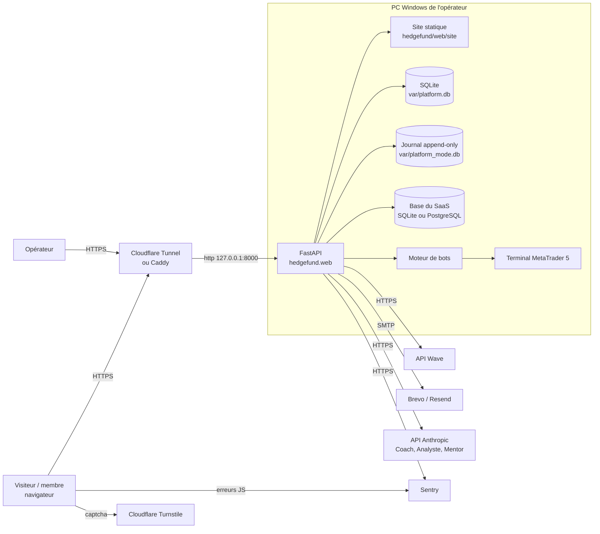

# TRD : architecture technique (v0.4)

> Technical Requirements Document. **Comment** le produit est construit. Le besoin est dans
> [PRD.md](PRD.md) ; les tables et routes dans [BACKEND_SCHEMA.md](BACKEND_SCHEMA.md).

## 1. Vue d'ensemble

Un seul processus Python sert tout, sur une seule adresse :



- **Pas de Node.js en production** : le site Next.js est exporté en HTML statique
  (`npm run publish-site`) et copié dans `hedgefund/web/site`, servi par FastAPI.
- **Même origine** pour le site et l'API : pas de CORS, cookies `SameSite`, CSP stricte.
- **SQLite** (mode WAL) pour l'état ; journal **append-only chaîné par hash** pour l'audit.
- **Espace de trading (SaaS)** : `hedgefund/saas`, monté dans le même processus (désactivable par
  `HF_SAAS=0`), base SQLAlchemy (`sqlite:///var/saas.db` par défaut, PostgreSQL avec RLS en
  production), agents IA orchestrés par LangGraph. Détails : [SAAS.md](SAAS.md).

## 2. Stack

| Couche | Technologie | Version |
|---|---|---|
| Langage serveur | Python | ≥ 3.11 (testé en 3.13) |
| API | FastAPI + Uvicorn, Pydantic v2 | fastapi ≥ 0.110 |
| Front | Next.js (export statique, Turbopack), React, TypeScript, Tailwind CSS v4, Framer Motion, lucide-react | next 16.3, react 19.3, tailwind 4.3 |
| Base de données | SQLite (stdlib `sqlite3`) pour la plateforme ; SQLAlchemy (SQLite ou PostgreSQL + RLS) pour le SaaS | sqlalchemy ≥ 2 |
| Trading | MetaTrader5 (Windows), flux simulé ailleurs | — |
| IA | SDK `anthropic`, LangGraph ; modèles par clé logique dans `config/models.yaml` (IDs exacts, jamais d'alias flottant) | anthropic ≥ 1.8, langgraph ≥ 1 |
| E-mail | `smtplib` (stdlib), tout fournisseur SMTP | — |
| Anti-bot | Cloudflare Turnstile (optionnel) | — |
| Supervision | `sentry-sdk[fastapi]` (serveur), `@sentry/browser` chargé à la demande (site) | sentry-sdk ≥ 2, @sentry/browser 10 |
| Tests | pytest, httpx (TestClient), Playwright (contrôles visuels) | pytest ≥ 8 |
| CI | GitHub Actions `.github/workflows/tests.yml` | — |

> **Attention Next.js** : `apps/web/AGENTS.md` rappelle que cette version de Next.js a des
> changements incompatibles. Avant de modifier le front, lire le guide concerné dans
> `apps/web/node_modules/next/dist/docs/`.

## 3. Arborescence utile

```
config/site.yaml              offres, prix, textes, robots affichés (modifiable sans code)
hedgefund/web/app.py          application FastAPI, sécurité, CSP, routes console
hedgefund/web/security.py     mots de passe scrypt, sessions, CSRF, TOTP, anti-bruteforce
hedgefund/web/observability.py Sentry (serveur + config du site)
hedgefund/members/api.py      routes /api/site, /api/m, /api/admin, webhook Wave
hedgefund/members/service.py  comptes, confirmation e-mail, reset, paiements, accès
hedgefund/members/mailer.py   envoi SMTP + modèles d'e-mails
hedgefund/members/antibot.py  e-mails jetables, Turnstile
hedgefund/members/academy.py  cours vidéo
hedgefund/members/copytrading.py copytrading démo
hedgefund/saas/               espace de trading : journal, statistiques, Coach, Analyste, risque, Mentor…
hedgefund/saas/fiches_ict/    fiches ICT du Mentor (une par sujet, Markdown)
config/saas.yaml, models.yaml fonctions et quotas par offre ; modèles IA
apps/web/src/app/             pages du site (une route = un dossier page.tsx + view.tsx) ; /app/ = espace de trading
apps/web/src/components/      UI partagée (chrome, ui, turnstile, brand…)
apps/web/src/lib/             client API, session
apps/motion/                  film de présentation (Remotion), isolé du produit
tests/                        tests automatiques (316)
```

## 4. Sécurité

| Sujet | Mise en œuvre |
|---|---|
| Mots de passe | scrypt (N=2^15, r=8, p=1), sel 16 octets, 12 caractères min |
| Sessions | jeton 256 bits, seul son SHA-256 est stocké ; expiration absolue + inactivité ; cookie `HttpOnly`, `Secure`, `SameSite=Lax` (membres) / `Strict` (console) |
| CSRF | jeton par session dans `X-CSRF-Token` + contrôle de l'`Origin` sur toute écriture |
| Force brute | 5 échecs/15 min par login, 20 par IP |
| Inscription | piège invisible, domaines jetables, 5 inscriptions/h/IP, Turnstile optionnel, confirmation e-mail |
| Liens e-mail | jetons aléatoires, hachés en base, usage unique, 48 h (confirmation) / 60 min (reset) ; origine = `LF_PUBLIC_URL` ou `HF_PUBLIC_HOST`, jamais l'en-tête Host |
| Énumération | « renvoyer le lien » et « mot de passe oublié » répondent pareil que l'adresse existe ou non |
| En-têtes | CSP par page (scripts inline autorisés par hash), HSTS, `X-Frame-Options: DENY`, `no-referrer` |
| CSP tierces | Turnstile (`challenges.cloudflare.com`) et Sentry (hôte d'ingestion) ajoutés **seulement** s'ils sont configurés |
| Webhook Wave | signature HMAC vérifiée ; le paiement est relu depuis l'API Wave avant crédit |
| Journal | toute action opérateur et événement sensible (paiement, reset, e-mail confirmé, inscription bloquée) dans le journal append-only |
| Sentry | pas de corps de requête, cookies, en-têtes sensibles, jetons ni e-mails ; `send_default_pii=False` |

## 5. Composants v0.4

### 5.1 Confirmation d'e-mail

- Colonne `members.email_verified_at` ; table `email_tokens` (hash, membre, but, expiration,
  utilisation). Migration automatique au démarrage : les comptes existants sont marqués
  confirmés à leur date de création.
- `Members.register` → compte en attente → `send_verification` → e-mail → `POST /api/m/verify`
  consomme le jeton, confirme, ouvre la session.
- `member_opt` et `entitlements` refusent un compte non confirmé (défense en profondeur).
- Purge paresseuse : à chaque inscription, suppression des comptes non confirmés de plus de
  7 jours sans paiement.
- Désactivable (`LF_EMAIL_VERIFICATION=0`) pour un usage local.

### 5.2 E-mail

`mailer_from_env()` : `SmtpMailer` si `LF_SMTP_HOST` est défini (envoi dans un thread, erreurs
journalisées et donc remontées à Sentry), sinon `LogMailer` (écrit le lien dans le journal du
serveur et avertit au démarrage). Modèles HTML sobres + texte brut, contenu échappé.

### 5.3 Questions ICT : le Mentor

La v0.4 avait un « Coach IA » séparé (`/coach/`). À l'intégration, ses 15 fiches ICT sont
devenues une source du **Mentor** de l'espace de trading : un seul assistant, un seul quota.

- `hedgefund/saas/fiches_ict/*.md` : une fiche par sujet, indexée à chaque démarrage (et par
  « Réindexer » dans l'admin) avec les définitions du moteur (`.claude/skills/*/SKILL.md`) et les
  cours de l'académie (`hedgefund/saas/knowledge.py`, source `fiche_ict`, accès `academy_member`).
  Les documents ajoutés par l'équipe ne sont jamais effacés par la réindexation.
- Recherche lexicale BM25 filtrée par les droits du membre **avant** le classement ; le modèle
  reçoit les passages comme des données et doit citer ceux qu'il utilise ; tout chiffre de la
  réponse doit figurer dans un passage (`ungrounded_numbers`), sinon la réponse IA est écartée
  et les extraits sont affichés tels quels.
- Demande de conseil personnalisé : refus explicite (`REFUSED_ADVICE`) ; question non couverte :
  `OUT_OF_CORPUS`.
- Quota mensuel par offre et plafond de coût IA (`config/saas.yaml`) ; modèle `mentor` dans
  `config/models.yaml`.
- Chaque question est inscrite dans le registre d'audit du SaaS ; `GET /api/admin/mentor/questions`
  les liste pour l'équipe, sans nom ni e-mail.

### 5.4 Sentry

- Serveur : `init_sentry()` dans `build_platform()` ; intégrations FastAPI et logging
  automatiques ; `before_send` nettoie les événements ; release `liberte-financiere@<version>`.
- Site : `/api/site` expose `sentry: {dsn, environment, release}` si `SENTRY_BROWSER_DSN` est
  défini ; `session.tsx` charge `@sentry/browser` à la demande ; les URL sont tronquées avant
  le `?` (jetons).

## 6. Configuration (variables d'environnement)

Sous Windows, dans `.env.ps1` (copié depuis `deploy/windows/env.example.ps1`).

| Variable | Rôle | Défaut |
|---|---|---|
| `HF_FEED` | `auto`, `mt5`, `simulation` | `auto` |
| `HF_HOST` / `HF_PORT` | écoute | `127.0.0.1` / `8000` |
| `HF_COOKIE_SECURE` | cookies `Secure` (mettre 0 seulement en http local) | `1` |
| `HF_PUBLIC_HOST` | domaine public derrière le tunnel | — |
| `HF_TRUST_PROXY` | lire l'IP réelle derrière Cloudflare/Caddy | `0` |
| `HF_ALLOW_REAL_TRADING` | autoriser l'argent réel | `0` |
| `LF_PUBLIC_URL` | `https://votre-domaine` : liens Wave et e-mails | — |
| `LF_WAVE_API_KEY`, `LF_WAVE_WEBHOOK_SECRET` | Wave Checkout | — |
| `LF_REGISTRATION` | inscriptions ouvertes | `1` |
| `LF_EMAIL_VERIFICATION` | confirmation d'e-mail obligatoire | `1` |
| `LF_SMTP_HOST`, `LF_SMTP_PORT`, `LF_SMTP_USER`, `LF_SMTP_PASSWORD`, `LF_SMTP_SECURITY`, `LF_MAIL_FROM` | envoi des e-mails | — / 587 / — / — / `starttls` / — |
| `LF_TURNSTILE_SITE_KEY`, `LF_TURNSTILE_SECRET` | Cloudflare Turnstile | — |
| `LF_BLOCKED_EMAIL_DOMAINS` | domaines refusés en plus (virgules) | — |
| `ANTHROPIC_API_KEY` | textes rédigés par l'IA (Coach, Analyste, Mentor) ; sans clé, sorties des règles | — |
| `HF_SAAS`, `HF_SAAS_DB` | espace de trading on/off ; URL de sa base | `1` / `sqlite:///var/saas.db` |
| `HF_SECRET_KEY` | clé Fernet des mots de passe investisseur (à garder) | — |
| `HF_PUBLIC_URL` | adresse donnée à l'EA Journal Sync et à TradingView | — |
| `HF_DEMO_CONFIRMATION` | en démonstration seulement : `1` montre l'étape de confirmation d'e-mail | `0` |
| `SENTRY_DSN`, `SENTRY_BROWSER_DSN`, `SENTRY_ENVIRONMENT`, `SENTRY_TRACES_SAMPLE_RATE` | Sentry | — / — / `production` / 0.1 |
| `LF_COPYTRADING` | `off`, `demo` | `demo` |
| `LF_MEDIA_HOSTS` | domaines vidéo autorisés | — |

## 7. Qualité

- `pytest -q` doit passer (316 tests après l'intégration de la v0.4) avant tout commit ; la CI le
  refait, avec la recherche de secrets (`scripts/check_secrets.py`) et `ruff`.
- Front : `npm run lint` (TypeScript) puis `npm run publish-site` pour reconstruire
  `hedgefund/web/site`.
- Vérification visuelle avec Playwright (MCP Playwright dans Claude Code) sur 1 360 px et
  390 px.
- Les nouveaux fichiers Python passent `ruff check`.

## 8. Décisions d'architecture

| Décision | Pourquoi |
|---|---|
| Un seul processus, SQLite | Un opérateur, un PC, zéro administration de base de données ; suffisant pour quelques milliers de membres |
| Export statique du site | Pas de Node en production, CSP stricte, sécurité plus simple |
| SMTP générique plutôt qu'un SDK | Changer de fournisseur = changer 4 variables |
| Fiches ICT en Markdown dans le dépôt | Relues, versionnées et corrigées comme du code ; pas de base vectorielle à maintenir |
| Un seul assistant (le Mentor) pour les questions ICT | Mêmes droits, quota, garde-fous et registre d'audit que le reste du SaaS ; les fiches s'ajoutent aux cours et aux définitions du moteur |
| Recherche BM25 plutôt que toute la base dans le prompt | Le corpus grandit avec les cours ; le filtre par droits doit s'appliquer avant le modèle ; les chiffres sont vérifiés contre les passages cités. Un index vectoriel viendra si la fidélité plafonne (ADR-010, [SAAS.md](SAAS.md)) |
| Sentry optionnel | La plateforme ne dépend d'aucun service tiers pour fonctionner |

## 9. Dette technique connue

- `SameSite=Lax` et sessions membres de 72 h : à revoir si une app mobile arrive.
- Les e-mails partent d'un thread du processus : en cas d'arrêt brutal, un e-mail en cours
  peut être perdu (le membre peut renvoyer le lien).
- Pas encore de relance automatique avant expiration des abonnements.
- `app.py` (Streamlit, licences ICT Pure Master) reste séparé et utilise SHA-256 non salé pour
  son admin : à migrer ou retirer.
- Le dépôt GitHub est public : passer en privé.
